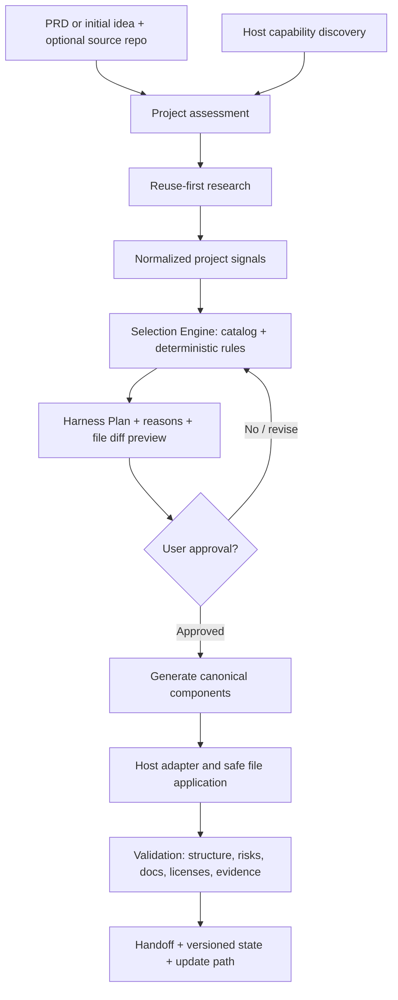

# Architecture — Current State vs Target State

## Current State (verified for this starter archive)

- A documented project intent (`PRD.md`) and a proposed set of policies, test cases, and architecture contracts exist.
- A JSON schema and an example Harness Plan are present; they are starting contracts, not a working runtime.
- A draft module catalog exists; rules are **not executed** by an implemented Selection Engine.
- A local documentation/package validator exists. It does **not** audit security of generated customer projects.
- No implemented CLI, adaptive planner, native adapters, runtime subagent orchestration, production installer, deployment integration, or end-to-end generator test suite exists.

## Target State (design proposal; not yet implemented)

### Core interfaces (proposed)

- `ProjectAssessment`: scope, currentRepo, known requirements, stack, surfaces, feature scale, system scale, data classifications, external dependencies, sensitive actions, user mode, unknowns, evidence.
- `HostCapabilities`: host, version, canReadRepo, canWriteRepo, network, subagents, hooks, permissions, supportsSkillFormat, known limitations.
- `ReuseEvaluation`: candidates with verified URLs/licenses/date/evidence, fit/maintenance/risks; recommended build/adapt/buy; unverified markers.
- `ModuleDefinition`: id, category, whenRequired, whenSuggested, whenNotApplicable, dependencies, conflicts, supports, files, effort, source/provenance.
- `HarnessPlan`: assessment snapshot, policy version, module decisions, skips, blockers, target file operations, safety constraints, user-facing rationale, approval status; JSON Schema in `schemas/harness-plan.schema.json`.
- `ApplyResult`: exact file changes, conflicts, rollback information, generated provenance and executed validations. No fabricated `PASS`.
- `ValidationReport`: structural/semantic/host/evidence/license/doc-consistency checks with severity and remediation.

### Components and responsibility

| Component | Responsibility | Non-responsibility |
|---|---|---|
| Intake & normalization | Turn user idea/PRD/repo into explicit facts and unknowns | No engineering defaults disguised as user intent |
| Assessment | Recognize project, scale, risk, existing conventions | No unilateral production changes |
| Reuse-first researcher | Find and evaluate OSS/service candidates | No auto-import/execute of third-party source |
| Selection Engine | Choose module subset with explainable deterministic policy | No unlimited dynamic LLM freehand generation |
| Plan/Approval | Show selected/skipped files, impact, effort, risks | No changes before approval |
| Library | Canonical definitions for skills, agents, rules, templates | No blanket installation |
| Adapters | Translate selected canonical items to host formats | No unsupported feature claims |
| Generator | Apply approved changes safely and idempotently | No clobbering user files |
| Validator | Compare policy, plan, output, evidence, provenance and docs | No blanket promise of security/compliance |
| Maintainer | Inspect drift, incremental updates, handoff | No rewriting user customizations without review |

### Source of truth hierarchy

- Product intent: `docs/PRD.md`.
- Implemented vs planned architecture: `docs/ARCHITECTURE.md`.
- Accepted architectural decisions: `docs/DECISIONS.md`.
- Core selection behavior: `docs/SELECTION_POLICY.md` + future executable policies (policy versioned).
- Each feature's acceptance: relevant feature spec and `docs/ACCEPTANCE.md`.
- Source/license provenance: `THIRD_PARTY_NOTICES.md`, `INSPIRATIONS.md` and future per-file machine-readable entries.
- Delivery order: `docs/ROADMAP.md`.
- Coverage: `docs/TRACEABILITY.md`.

Canonical truth is declared once; adapters and convenience docs reference it rather than duplicating conflicting rules.

### Two scales of adaptivity

1. **Generator configuration scale:** project purpose, complexity, security/privacy sensitivity, existing stack, host capabilities, novice/developer mode, and user preferences determine the installed Harness.
2. **Generated project workflow scale:** later feature-specific changes can select quick/standard/full paths without installing an entirely different global Harness.

Security applies to both levels independently. A small app processing sensitive data may require stronger controls than a large offline demo.

### Generated project artifacts (selected only when justified)

- Small: concise agent entrypoint/README, PRD or intent, task guidance, tests and security baseline.
- Larger: specification/change management, architecture/current-target state, ADRs, contracts, dependency and test plans, independent read-only review, documentation-impact checks, handoff state.
- UI: user flows/design system/screens only when applicable.
- API/db: contract/migration/backup plans only when touched.
- Payments/sensitive data/production: stronger required security, permission and release checks; no unsafe bypass by choosing a smaller route.

### Trust boundaries

External README/skills, search results, issue discussions and repository data are **untrusted content**. A borrowed agent skill must be manually/automatically audited before becoming executable policy. Prompt instructions are advisory unless enforced by host permissions/technical checks. Generated outputs must not contain secrets, unsupported claims or unapproved third-party dependencies.

### Non-goals and unresolved architecture choices

See `docs/DECISIONS.md`. Do not assume a custom LLM SDK, database, web UI or a paid service until MVP evidence requires one.
